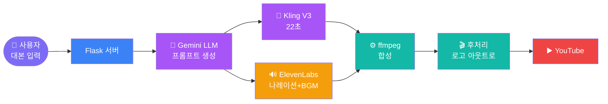
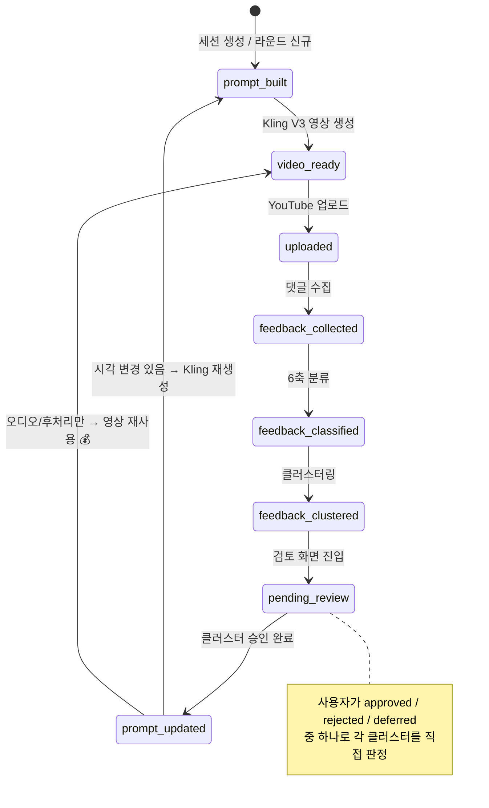
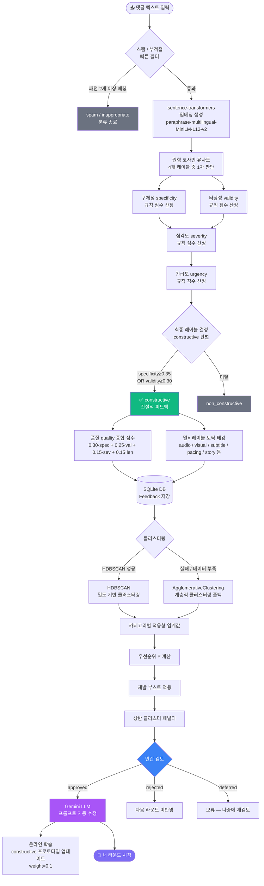
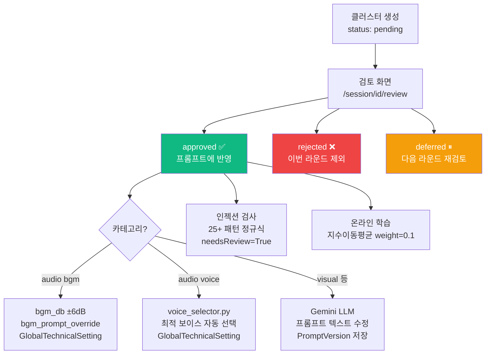
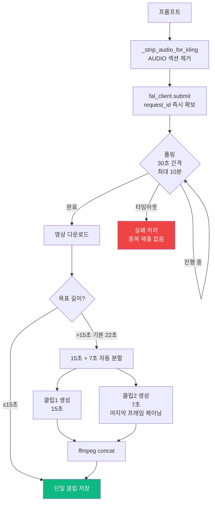
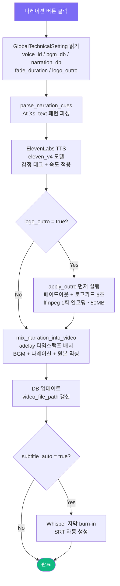
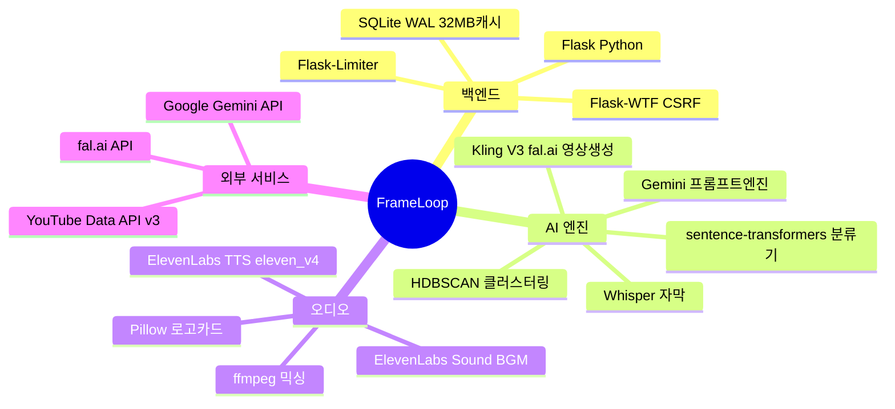
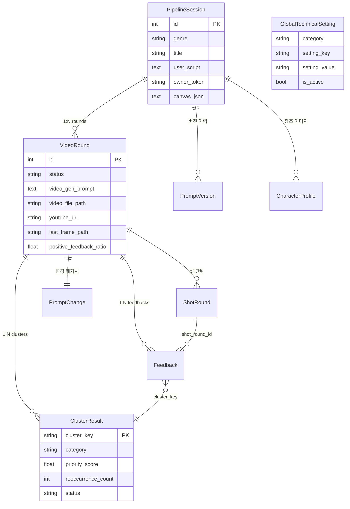

# FrameLoop — AI 영상 피드백 자동 개선 시스템

> **군산대학교 임베디드소프트웨어학과 졸업작품**  
> Flask · SQLite · Kling V3 · ElevenLabs · Gemini

---

## 🎬 인터랙티브 파이프라인 블럭도

> 아래 링크를 클릭하면 **14단계 애니메이션 블럭도**가 새 탭에서 열립니다.

**[▶ FrameLoop 파이프라인 블럭도 보기](https://htmlpreview.github.io/?https://github.com/Userlsj-project/VideoLabs/blob/main/diagram.html)**

---

## 1. 프로젝트 개요

**FrameLoop**는 AI로 생성한 유튜브 영상의 시청자 댓글을 자동 분석하고, 그 피드백을 다음 라운드 영상에 자동 반영하는 **자동 피드백 루프 시스템**입니다.

```
시청자 댓글 → AI 분류 → 클러스터링 → 사용자 승인 → 프롬프트 자동 수정 → 새 영상 생성 → 반복
```

| 항목 | 내용 |
|------|------|
| **차별점** | 단순 영상 생성이 아닌 "피드백 DNA" — 라운드가 쌓일수록 영상이 시청자 취향에 최적화 |
| **서버** | Flask 단일 서버 (포트 5000), SQLite WAL 모드 |
| **영상 생성** | fal.ai Kling V3 Standard — 22초 기준 약 $1.85 |
| **오디오** | ElevenLabs TTS(나레이션) + Sound(BGM) — 무료 플랜 |
| **프롬프트 엔진** | Gemini `gemini-3.1-flash-lite` (결제 미연결 프로젝트) |

---

## 2. 전체 파이프라인

**① 영상 제작**



**② 피드백 분석 루프**


---

## 3. VideoRound 상태 머신

각 라운드는 아래 상태를 순서대로 거칩니다.  
**오디오 피드백만 있을 경우** 영상 재생성 없이 `video_ready`로 바로 진입해 비용을 절감합니다.



> **서버 재시작 안전장치**: `generating` 상태로 멈춘 좀비 라운드는 서버 시작 시 `prompt_built`로 자동 복구됩니다.

---

## 4. 댓글 클러스터링 파이프라인 ⭐ 핵심

### 4-1. 전체 흐름



---

### 4-2. 6축 피드백 분류 점수

각 댓글은 아래 6가지 축으로 **동시에** 점수화됩니다.

| 축 | 설명 | 판단 방식 | 활용 |
|----|------|-----------|------|
| **specificity** | 구체성 — 얼마나 명확한 요구인가 | 키워드 패턴 점수 (≥0.35 → constructive) | constructive 판별 기준 |
| **validity** | 타당성 — 근거가 있는 의견인가 | 키워드 패턴 점수 (≥0.30 → constructive) | constructive 판별 보조 |
| **severity** | 심각도 — 시청에 얼마나 방해되는가 | 패턴 점수 (음수 = 경미) | 우선순위 가중치 |
| **urgency** | 긴급도 — 즉각 처리가 필요한가 | 패턴 점수 | 우선순위 가중치 |
| **quality** | 품질 종합 | 5축 + 길이 + 수치 포함 여부 합산 | 대표 텍스트 선택 |
| **actionability** | 실행가능성 | 기본값 0.5 | 클러스터 우선순위 보조 |

> **언어 감지**: 한국어/영어/일본어/중국어/혼합어 자동 감지.  
> 한 언어가 70% 미만이면 `mixed_ko_en` 등으로 분류합니다.

---

### 4-3. 클러스터링 알고리즘

#### 카테고리별 적응형 거리 임계값

| 카테고리 | 임계값 | 이유 |
|----------|--------|------|
| `technical` | **0.26** | 기술 이슈는 표현이 매우 구체적 → 좁게 |
| `subtitle` | **0.30** | 자막 피드백은 구체적 표현 집중 |
| `visual` | **0.36** | 색감/조명은 표현 중간 |
| `audio` | **0.38** | 오디오 피드백은 표현 다양 |
| `other` | **0.40** | 기타 |
| `content` | **0.44** | 내용 구성은 표현 다양 |
| `pacing` | **0.42** | 속도/편집은 표현 다양 |
| `story` | **0.48** | 스토리는 표현이 매우 다양 → 넓게 |

- **대형 클러스터(> 15개)**: 임계값 × 0.58 로 서브클러스터링 자동 실행
- **응집도(cohesion)**: 클러스터 내 쌍별 코사인 유사도 평균으로 계산

---

### 4-4. 우선순위 공식

$$P = 0.35 \times \text{freq} + 0.25 \times \text{quality} + 0.20 \times \text{severity} + 0.12 \times \text{urgency} + 0.08 \times \text{validity}$$

```
P = 0.35 × 빈도점수
  + 0.25 × 평균 품질점수
  + 0.20 × 평균 심각도점수
  + 0.12 × 평균 긴급도점수
  + 0.08 × 평균 타당성점수
```

#### 보정 규칙

| 상황 | 보정 | 최대값 |
|------|------|--------|
| 재발 1회 (이전 라운드에도 등장) | P × **1.10** | — |
| 재발 2회 | P × **1.20** | — |
| 재발 3회 이상 | P × **1.30** | 1.0 상한 |
| 상반된 피드백 클러스터 존재 | P × **0.60** | — |

> 예: "BGM 줄여주세요"와 "BGM 더 키워주세요"가 동시에 등장하면, 두 클러스터 모두 40% 감산됩니다.

---

### 4-5. 클러스터 승인 워크플로



---

## 5. 피드백 자동 반영 요약

> **핵심 원칙**: 피드백 적용 = "나레이션 버튼" 한 번으로 모든 설정이 자동 반영됩니다.

| 피드백 예시 | 자동 처리 | 저장 위치 | 적용 시점 |
|------------|-----------|-----------|---------|
| "BGM이 너무 커요" | bgm_db **-6dB** | `GlobalTechnicalSetting` audio.bgm_db | 나레이션 버튼 |
| "배경음악이 너무 작아요" | bgm_db **+6dB** | `GlobalTechnicalSetting` audio.bgm_db | 나레이션 버튼 |
| "나레이션이 잘 안 들려요" | narration_db **+3dB** | `GlobalTechnicalSetting` audio.narration_db | 나레이션 버튼 |
| "배경음악 더 웅장하게" | bgm_prompt_override 저장 | `GlobalTechnicalSetting` audio.bgm_prompt_override | BGM 버튼 |
| "목소리 바꿔주세요" | voice_selector → 5종 중 자동 선택 | `GlobalTechnicalSetting` voice.voice_id | 나레이션 버튼 |
| "끝부분을 자연스럽게" | fade_duration **2.5초**로 확장 | `GlobalTechnicalSetting` video_post.fade_duration | 나레이션 버튼 |
| "로고 넣어주세요" | logo_outro = **true** | `GlobalTechnicalSetting` video_post.logo_outro | 나레이션 버튼 |
| "화면이 더 밝았으면" | Gemini LLM이 프롬프트 style 섹션 수정 | `PromptVersion` (unified diff 저장) | Kling 버튼 |

---

## 6. 영상 생성 — Kling V3



| 항목 | 값 |
|------|----|
| 단가 | $0.084 / 초 (오디오 OFF) |
| 22초 영상 | **$1.85** (~₩2,680) |
| 최대 클립 | 15초 / 요청 |
| 일일 안전 한도 | `MAX_PAID_GENERATIONS_PER_DAY=20` |
| 프롬프트 최대 | 2,500자 |

---

## 7. 나레이션 파이프라인



> **BGM 동점 분류 로직**: "음악을 줄이거나 나레이션소리를 키우면" 처럼 bgm/voice 점수가 동점인 경우, BGM 볼륨 액션 키워드(줄여/낮춰/줄이) 포함 여부로 최종 분류합니다.

---

## 8. 보안 설계

| 위협 | 방어 방식 |
|------|----------|
| **프롬프트 인젝션** | 25+ 패턴 정규식 감지 → `needs_review=True` 마킹, LLM 피드백 데이터를 `<feedback_data>` XML 태그로 격리 |
| **SSRF** | `_validate_image_url()` — 허용 도메인 7개 화이트리스트, 내부 IP 차단 |
| **경로 탐색** | `_safe_send_file()` — `os.path.realpath()` + upload_root 경계 검사 |
| **SQL 인젝션** | SQLAlchemy ORM 파라미터 바인딩 (raw SQL 미사용) |
| **CSRF** | Flask-WTF (1시간 토큰) |
| **Rate Limit** | Flask-Limiter (AI API 10/분, 변형 5/분) |
| **레이스 컨디션** | `_narration_running: dict[id, float]` 락 + 10분 자동 해제 |
| **파일 업로드** | 확장자 검증 + 500MB 제한 |
| **API 키 노출** | `utils/masking.py` — 로그 마스킹 |

---

## 9. 기술 스택



| 모듈 | 모델 / 버전 | 역할 |
|------|------------|------|
| 피드백 분류 | `paraphrase-multilingual-MiniLM-L12-v2` | 6축 분류 (코사인 유사도) |
| 클러스터 임베딩 | `paraphrase-multilingual-mpnet-base-v2` | 문장 임베딩 생성 |
| 프롬프트 엔진 | `gemini-3.1-flash-lite` | 프롬프트 생성·수정 |
| 영상 생성 | `fal-ai/kling-video/v3/standard/text-to-video` | 22초 영상 |
| TTS | ElevenLabs `eleven_v4` | 나레이션 5종 보이스 |
| 자막 | OpenAI Whisper (로컬 small) | SRT 자막 |

---

## 10. DB 모델 관계도



---

*최종 업데이트: 2026-10-27 | 16차 세션 완료*
